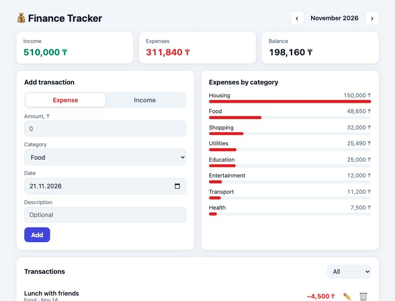

# 💰 Finance Tracker

[](https://github.com/MakeMV/finance-tracker/actions/workflows/ci.yml)

A fullstack app for tracking **income and expenses**: a REST API on **Node.js + Express + SQLite**
and a responsive frontend in **vanilla JavaScript**.

**🔗 Live demo: https://finance-tracker-umdu.onrender.com**
<sub>Hosted on Render's free plan: the first load after a period of inactivity can take up to a minute while the server wakes up. Demo data resets on restart.</sub>



## Features

- ➕ Add, ✏️ edit and 🗑️ delete transactions
- 📅 Browse by month: income, expenses and balance for each month
- 📊 Expenses broken down by category
- 🔎 Filter the list by type (income / expenses)
- 📷 **Scan a receipt**: upload a photo and the amount, date, category and store are filled in for you (Claude vision API)
- ✅ Server-side validation with clear error messages
- 🌗 Light & dark theme with a toggle (follows the system until you choose, remembered between visits)
- 📱 Responsive layout

## Tech stack

| Layer | Technology |
|---|---|
| Backend | Node.js, Express 5 |
| Database | SQLite (built-in `node:sqlite`, no native dependencies) |
| Frontend | HTML, CSS (Grid, custom properties), vanilla JavaScript (ES modules, Fetch API) |
| AI | Claude API (`@anthropic-ai/sdk`): vision + structured outputs for receipt scanning |
| Tests | Node.js built-in test runner (`node:test`) |
| DevOps | Docker, GitHub Actions (tests on Node 24 & 26, Docker build + smoke test) |

## Getting started

Requires **Node.js 22.13+** (24 or newer recommended).

```bash
git clone https://github.com/MakeMV/finance-tracker.git
cd finance-tracker
npm install
npm run seed   # optional: add demo data
npm start
```

Open http://localhost:3000.

| Command | What it does |
|---|---|
| `npm start` | Start the server |
| `npm run dev` | Start with auto-restart on file changes |
| `npm test` | Run the API tests |
| `npm run seed` | Fill the database with demo transactions |

### With Docker

```bash
docker build -t finance-tracker .
docker run -p 3000:3000 -v finance-data:/app/data finance-tracker
```

The `-v` volume keeps your data when the container is restarted.

### Configuration

| Variable | Default | Description |
|---|---|---|
| `PORT` | `3000` | HTTP port |
| `DB_FILE` | `data/finance.db` | Path to the SQLite database file |
| `SEED_DEMO` | — | Set to `true` to fill an empty database with demo data on start |
| `ANTHROPIC_API_KEY` | — | Turns on receipt scanning. Without it the "Scan receipt" button is hidden |
| `RECEIPT_MODEL` | `claude-opus-5-5` | Claude model used to read receipts |

### Deploy to Render

The repo includes a [`render.yaml`](render.yaml) Blueprint: in the Render dashboard choose
**New → Blueprint**, pick this repository and click **Apply**. It builds the Dockerfile on the free plan.

> The free plan has no persistent disk, so the database resets when the service restarts.
> `SEED_DEMO=true` refills it with demo data, which is fine for a portfolio demo.

## API

All endpoints are under `/api` and use JSON.

| Method | Endpoint | Description |
|---|---|---|
| `GET` | `/api/categories` | Income and expense categories |
| `GET` | `/api/transactions?month=2026-11&type=expense&category=Food` | List transactions (all filters optional) |
| `GET` | `/api/transactions/:id` | Get one transaction |
| `POST` | `/api/transactions` | Create a transaction → `201` |
| `PUT` | `/api/transactions/:id` | Update a transaction |
| `DELETE` | `/api/transactions/:id` | Delete a transaction → `204` |
| `GET` | `/api/summary?month=2026-11` | Income, expenses, balance and expenses by category |
| `GET` | `/api/receipts/status` | Whether receipt scanning is enabled |
| `POST` | `/api/receipts/scan` | Body: the image (`Content-Type: image/jpeg`, png, webp or gif, up to 5 MB). Returns the recognized fields; saves nothing |

Example:

```bash
curl -X POST http://localhost:3000/api/transactions \
  -H "Content-Type: application/json" \
  -d '{"type":"expense","amount":2500,"category":"Food","description":"Lunch","date":"2026-11-21"}'
```

Invalid data returns `400` with a list of problems:

```json
{ "errors": ["amount must be a positive number", "date must be a valid date in YYYY-MM-DD format"] }
```

## Receipt scanning

1. The browser shrinks the photo to 1600px JPEG (a 5 MB phone photo becomes ~300 KB).
2. The server sends it to Claude with a **JSON schema** (structured outputs), so the answer is always
   valid JSON with `total`, `date`, `merchant`, `category` (one of the app's categories)…
3. The server **checks the answer again** (valid date, positive amount, known category) and
   the form is filled in. Nothing is saved until the user reviews it and presses **Add**.

Guard rails: rate limits (10 scans per IP per hour, 50 per day for the whole server) so a public demo
can't run up the API bill, a 5 MB upload limit, and the image is never stored.
The tests use a fake scanner, so they run without an API key or network.

## Project structure

```
finance-tracker/
├── src/
│   ├── server.js        # Entry point: opens the DB, starts HTTP server, graceful shutdown
│   ├── app.js           # Express app: middleware, routes, error handling
│   ├── routes/api.js    # REST endpoints
│   ├── routes/receipts.js # Receipt upload endpoint
│   ├── receipts.js      # Receipt scanning with the Claude API
│   ├── rate-limit.js    # In-memory rate limiter
│   ├── repository.js    # All SQL queries (parameterized)
│   ├── validation.js    # Input validation, money conversion
│   ├── categories.js    # Category lists
│   └── db.js            # SQLite connection and schema
├── public/              # Frontend (served as static files)
├── test/               # API and receipt scanning tests
├── scripts/seed.js      # Demo data
└── Dockerfile
```

## Design decisions

- **Money is stored as integers** (tiyn / cents): `12.34 ₸` → `1234`. Floating-point numbers can't
  represent most decimals exactly (`0.1 + 0.2 = 0.30000000000000004`), so totals would drift. A test checks this.
- **Parameterized SQL** everywhere (`WHERE id = ?`), so user input can never change a query (no SQL injection).
- **Layered backend**: routes → validation → repository → database. Each layer has one job and can be tested separately.
- **The database is injected into the app** (`createApp(db)`), so every test runs against its own fresh in-memory database.
- **The frontend never uses `innerHTML`** for user data, which prevents XSS.

## Roadmap

- [ ] User accounts and authentication (JWT)
- [ ] Monthly budgets per category with warnings
- [ ] Export to CSV
- [ ] Charts for trends over several months

## License

[MIT](LICENSE) © YerMukhammed Zadakhanov
